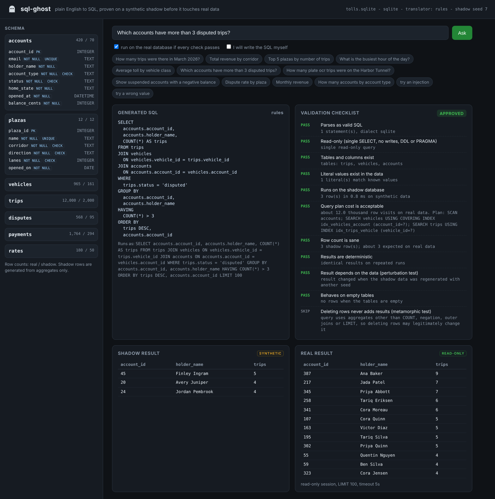
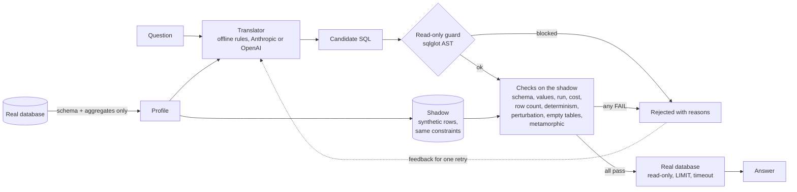
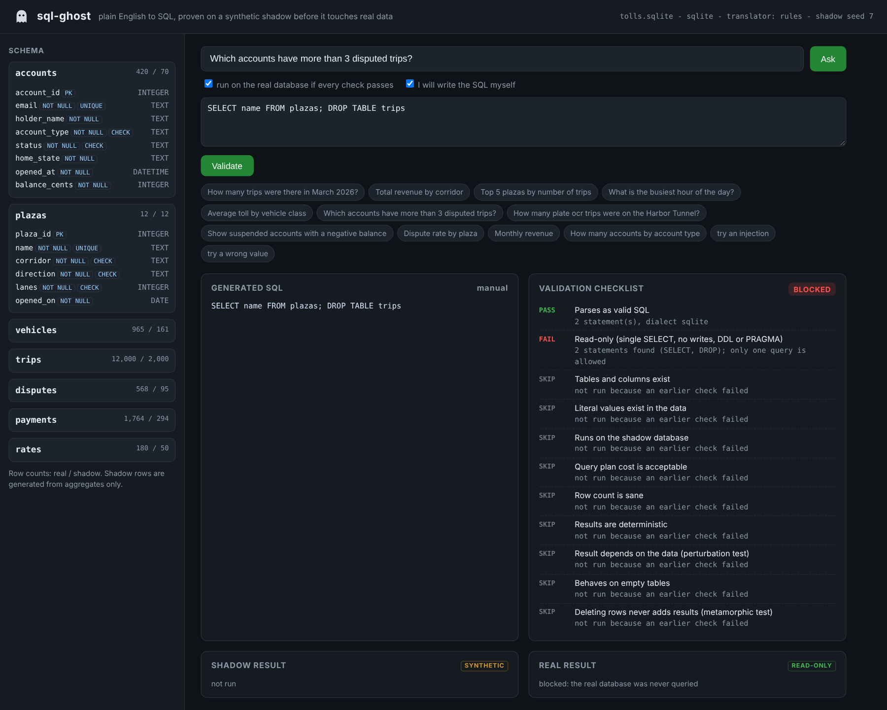

# sql-ghost

Natural language to SQL, validated against a synthetic shadow copy of your database.

Text-to-SQL tools usually work one of two ways. Either the model sees real rows (sample data in the prompt, or the model's query runs straight against production), or nobody checks the query until it has already run. sql-ghost does neither. It builds a **shadow database**: same tables, types, constraints, foreign keys and indexes as yours, filled with synthetic rows that follow your data's distributions. Every candidate query is proven on the shadow first. Only a query that passes every check is allowed near the real database, and then only in a read-only session with a row limit and a timeout.



```
$ sqlghost ask --db app.sqlite "Which accounts have more than 3 disputed trips?"
$ sqlghost validate "SELECT COUNT(*) FROM trips WHERE status = 'Disputed'"
$ sqlghost demo        # no API key needed
```

## Why a shadow database

**No production rows reach a model.** The translator (an LLM or the offline engine) sees the schema and a statistical profile. The profile holds row counts, null fractions, quantiles, text shapes ("email", "AAA9999") and the frequencies of low-cardinality values. It does not hold rows.

**The profile is small, readable and auditable.** `sqlghost profile` prints it as JSON. That printout is everything that left your database. Some rules it follows:

- A categorical value is kept only if at least 5 rows share it (k-anonymity style threshold), so a rare value that could identify someone is dropped.
- Primary keys, foreign keys and UNIQUE columns never get value frequencies.
- Text columns are reduced to a shape. The handful of values sampled to detect that shape never leave the profiler function.
- Allowed values in `CHECK (col IN (...))` constraints and Postgres enums come from the schema, not the data, so they are complete and safe to use.

**Validation happens where mistakes are free.** A bad query on the shadow costs nothing. The same query on production can lock tables, scan billions of rows, leak data through a side channel, or quietly return a wrong number that ends up in a report.

**The shadow is a real database, not a mock.** It enforces the same constraints as the source. Generated rows that violate a CHECK, UNIQUE or foreign key are refused by the engine and regenerated, so the shadow can only hold data your schema would accept.

## How it works



The shadow is built in three variants from one profile:

| Variant | Purpose |
|---|---|
| primary | Main shadow, seed 7. Most checks run here. |
| alt | Different seed and 75% of the size. If a result is identical here and on primary, it probably does not depend on the data. |
| empty | Schema only. Catches queries that misbehave on empty tables or return constants. |

## The checks

| Check | What it catches | Fails or warns |
|---|---|---|
| Parses as valid SQL | Syntax errors, in the source dialect | FAIL |
| Read-only | Anything that is not exactly one SELECT: writes, DDL, multiple statements, PRAGMA, ATTACH, `SELECT INTO`, `FOR UPDATE`, data-modifying CTEs, `load_extension`, `pg_sleep`, `pg_read_file`, `dblink`, system catalogs | FAIL |
| Tables and columns exist | Hallucinated tables and columns (resolved with sqlglot's qualifier) | FAIL |
| Literal values exist | `status = 'Disputed'` when the data only has `'disputed'`, with a suggestion | FAIL when the domain is complete, else WARN |
| Runs on the shadow | Runtime errors, wrong function arity, type errors, runaway queries (timeout) | FAIL |
| Plan cost | Cartesian products (from the AST) and plans that would visit too many real rows (from `EXPLAIN` and real row counts) | FAIL / WARN |
| Row count | Aggregates that return more than one row, empty results, results that will be capped by the limit | FAIL / WARN |
| Determinism | `LIMIT` without `ORDER BY`, `random()`, `now()`, results that differ between runs | WARN |
| Perturbation | Result identical on two independently generated datasets, a sign that filters never match | WARN |
| Empty tables | Errors on empty tables, constant queries | FAIL / WARN |
| Metamorphic | For monotone queries (plain joins and filters, grouped COUNTs): delete 30% of shadow rows in a rolled back transaction and confirm no rows or counts grow | FAIL |

The read-only rule is enforced twice. The guard walks the sqlglot syntax tree, so comments, quoting and nesting do not fool it the way they fool regex filters. Then the execution layer locks the session down on its own: on SQLite the file opens with `mode=ro`, `PRAGMA query_only` is on, and an authorizer callback refuses every operation except reads and allowed functions. On Postgres the transaction is `READ ONLY` with `statement_timeout` and `lock_timeout`, and it is always rolled back.

## Demo output

`sqlghost demo` runs end to end on the bundled sample database with no API key. The sample is a fictional toll road operator (four corridors, twelve plazas, 420 accounts, 12,000 trips over the first half of 2026). Every name, plate and email in it is made up. Excerpt:

```
sql-ghost demo
database : tolls.sqlite (bundled sample: a fictional toll road operator)
profile  : 7 tables, 15,909 real rows reduced to aggregates
shadow   : 2,682 synthetic rows, seed 7, same constraints and indexes
engine   : offline rule based translator (no API key needed)

Part 1. Questions in plain English

[2/8] Total revenue by corridor
    SELECT
      plazas.corridor,
      ROUND(SUM(trips.toll_cents) / 100.0, 2) AS revenue
    FROM trips
    JOIN plazas
      ON plazas.plaza_id = trips.plaza_id
    WHERE
      trips.status = 'posted'
    GROUP BY
      plazas.corridor
    ORDER BY
      revenue DESC
  APPROVED  10 pass, 0 warn, 0 fail, 1 skipped
    corridor          revenue
    ----------------  ---------
    Cascade Express   26,442.15
    Lakeside Bridge   17,793.50
    Harbor Tunnel     8,436.95
    Valley Connector  8,075.25

Part 2. Candidates that must never reach the real database

[1/8] A literal translator obeys a write request
  question: Delete all written-off trips
    DELETE FROM trips
    WHERE
      status = 'written_off'
  BLOCKED by "Read-only (single SELECT, no writes, DDL or PRAGMA)": statement type DELETE is not a query

[2/8] A model guessed the casing of a status value
    SELECT COUNT(*) FROM trips WHERE status = 'Disputed'
  BLOCKED by "Literal values exist in the data": trips.status never equals 'Disputed' (did you mean 'disputed'?)

[3/8] A second statement hidden after a comment
    SELECT name FROM plazas; -- just the names
    DROP TABLE trips
  BLOCKED by "Read-only (single SELECT, no writes, DDL or PRAGMA)": 2 statements found (SELECT, DROP); only one query is allowed

[7/8] An accidental cartesian join
    SELECT a.email, t.toll_cents FROM accounts a, trips t WHERE t.status = 'posted'
  BLOCKED by "Query plan cost is acceptable": cartesian product with no join condition: accounts x trips (about 1.3 million row visits on real data)

Summary
  8 of 8 questions passed every check and ran on the real database (read-only, LIMIT, timeout)
  8 of 8 bad candidates were blocked using only the shadow
```

The web UI shows the same thing for blocked queries: the real database is never queried.



## Quickstart

Python 3.11 or newer.

```bash
git clone https://github.com/ataperata/sql-ghost.git
cd sql-ghost
python -m venv .venv && source .venv/bin/activate
pip install -e .                 # add [postgres] for Postgres support, [dev] for tests

sqlghost demo                    # offline, uses the bundled sample
sqlghost serve                   # web UI on http://127.0.0.1:8765
```

Point it at your own SQLite file:

```bash
sqlghost schema  --db app.sqlite
sqlghost profile --db app.sqlite          # everything that leaves the database
sqlghost shadow  --db app.sqlite          # build the shadow and show a summary
sqlghost ask     --db app.sqlite "How many orders by status"
sqlghost ask     --db app.sqlite --no-run "..."   # validate only, never touch real data
sqlghost validate --db app.sqlite "SELECT ..." --run
echo "SELECT ..." | sqlghost validate --db app.sqlite -
```

Postgres needs a scratch database for the shadow schemas (`sqlghost_shadow`, `_alt`, `_empty`). Do not point `--shadow-url` at production.

```bash
pip install -e ".[postgres]"
sqlghost ask --db postgresql://reader@prod/app --shadow-url postgresql://me@localhost/scratch "..."
# pick a schema other than public with ?schema=sales on the --db URL
```

Every command takes `--limit` (default 100), `--timeout` (default 5 seconds), `--seed` and `--json`.

### Using an LLM

The offline engine handles a useful set of question shapes, but a model handles far more. Set one key and `--provider auto` (the default) picks it up:

| Provider | Key | Model override |
|---|---|---|
| Anthropic | `ANTHROPIC_API_KEY` | `SQLGHOST_ANTHROPIC_MODEL` (default `claude-sonnet-4-5`) |
| OpenAI | `OPENAI_API_KEY` | `SQLGHOST_OPENAI_MODEL` (default `gpt-4.1-mini`) |

The prompt holds the schema DDL, row counts and known categorical values. When a candidate fails validation, the failed checks are sent back for one retry. No row from the real database is ever part of a prompt, and the shadow results are not sent either.

### The offline engine

`sqlghost.nl.rules` is a template engine driven by the schema. Generic templates work on any database: "how many X [by Y]", "average/total/max X by Y", "top N X by Y", "which X have more than N Y", "show X with negative Y". It finds tables by name and synonym, follows foreign keys to join, and maps words in the question to categorical values ("plate OCR" becomes `read_type = 'plate_ocr'`). A few extra templates know the toll road sample (busiest hour, dispute rate, revenue). It is literal on purpose: ask it to delete something and it writes a DELETE, which the guard then blocks.

## Project layout

```
src/sqlghost/
  db.py         SQLite and Postgres connectors, introspection, locked down read-only execution
  profiler.py   aggregate statistics with k-anonymity style suppression
  checks.py     value domains from CHECK constraints
  synth.py      value generators driven by the profile
  shadow.py     shadow builder (FK order, UNIQUE tracking, constraint retry) and shadow queries
  guard.py      read-only guard on the sqlglot AST
  validate.py   the checks listed above
  nl/           offline rule engine, Anthropic and OpenAI translators
  engine.py     ties it together (Ghost class)
  cli.py        sqlghost command
  server.py     local web UI (standard library http.server)
  static/       single page UI
  sample.py     generator for the bundled toll road database
  data/         bundled tolls.sqlite
tests/          pytest suite, Postgres tests run when SQLGHOST_TEST_PG is set
```

## Development

```bash
pip install -e ".[dev]"
ruff check . && ruff format --check .
pytest -q
# Postgres integration tests:
SQLGHOST_TEST_PG=postgresql://postgres:pg@localhost/ghost_src \
SQLGHOST_TEST_PG_SHADOW=postgresql://postgres:pg@localhost/ghost_shadow pytest -q
python -m sqlghost.sample src/sqlghost/data/tolls.sqlite   # regenerate the sample
```

CI runs lint, the full suite (including Postgres 16 as a service) and the demo on Python 3.11 to 3.13.

## Limitations

- **The profile is not differential privacy.** Quantiles include the minimum and maximum of numeric and date columns, and a categorical value shared by 5 or more rows is listed. For most business data that is fine. For highly sensitive columns, review `sqlghost profile` before using a hosted model, or raise `profiler.K_ANON`.
- **Correlations between columns are not modeled.** Each column is generated on its own (foreign keys aside), so the shadow will not reproduce "fleet accounts have more class 5 vehicles". Checks are about whether a query is safe and well formed, not about matching real answers.
- **A passing query can still answer the wrong question.** The checks catch broken, unsafe, expensive and suspicious SQL, plus common semantic slips (wrong literal, constant results, arbitrary LIMIT). They cannot know that you meant gross revenue rather than net.
- **Cost estimates are rough.** SQLite has no cost model, so the estimate comes from `EXPLAIN QUERY PLAN` steps multiplied by real row counts and distinct counts. Postgres uses the real planner's cost (plan only, never executed).
- **CHECK constraints are read for simple forms only** (`IN`, `BETWEEN`, comparisons, `= ANY(ARRAY[...])`). Others are still enforced by the shadow database; rows that violate them are refused and regenerated, and a table may end up a little smaller.
- **Profiling reads every table.** Quantiles use `ORDER BY ... OFFSET`, which is fine for millions of rows but slow for billions. Sampling is not implemented yet.
- **Dialects:** SQLite and Postgres. sqlglot supports many more dialects, so the guard and checks would carry over; the connectors would not.
- **The web UI has no authentication** and binds to 127.0.0.1. Keep it local.

## License

MIT. See [LICENSE](LICENSE).
